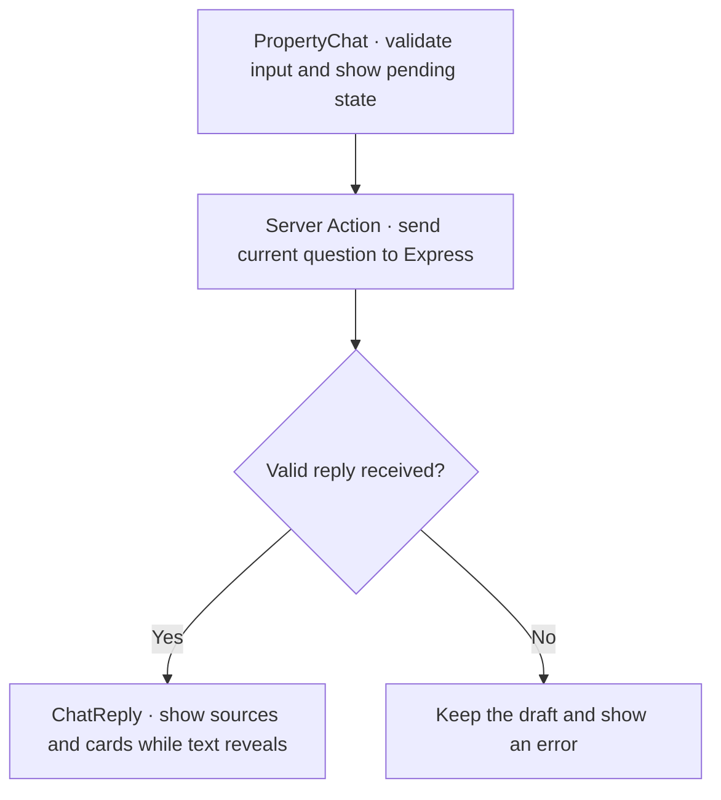

# Public property chatbot

Status: Verified opt-in demo for Phase 2 (P2-08). Real-business publication remains gated.

## Goal

Help website visitors find available properties in plain language, get sourced answers to agency questions and reach the existing inquiry form.

## Scope

- Public website chat, compact listing results, FAQ source links and inquiry navigation.
- Each request uses the current message. The panel shows the transcript while open in the current page session.
- Out of scope: staff or client portal access, durable chat history, direct bookings and automatic inquiry submission.

## User flow

1. Open **Ask about properties** on the public website and type a listing request or agency question.
2. Show progress and guard against duplicate submits. Keep the question available for retry if the request fails.
3. Render an answer with FAQ sources, a shortlist of up to three listings, a clarification question, or a no-results message. Show rental budgets as annual AED and link each listing to its existing property detail page and inquiry form. General inquiries go to Contact.

## Contracts and access

Send `{ message: string }` to `POST /api/v1/public/chat` through the existing same-origin API boundary. Consume generated types from the repository-local [OpenAPI snapshot](../../docs/contracts/public-chat.openapi.yaml), synchronized with the companion backend's `specs/public-property-chatbot/contract.md` and its local property-summary reference adaptation. The backend owns result facts, reference validation and provider access. Render responses as text and derive listing URLs from validated IDs. The chat UI prompts visitors to enter personal details in the inquiry form.

## Design

Mount a compact chat icon in the public layout. Keep it fixed at the bottom-right of the viewport on desktop and mobile, including when the footer is in view. Give it the accessible name **Ask about properties** and show the same tooltip on hover and keyboard focus. Open the panel at a consistent height of 38rem when space allows, with a viewport cap and a scrollable transcript. Keep chat state in the feature. Use existing dialog, button and field primitives where suitable, plus existing price and bedroom formatters for compact results. Support keyboard entry, Escape, focus return and polite status announcements. Fit at 320px without blocking access to the existing inquiry form.

Open in the docked view. The expand control centers a wider panel on desktop and fills most of the viewport on mobile. Collapse returns it to the bottom-right corner. Keep the transcript and draft in the same dialog during the switch. Use icon-only controls with accessible names and tooltips for expand, collapse, close and send. Show listing cards side by side when the transcript has enough width.

Once a complete reply arrives, reveal its text word by word. Show listing cards and source links immediately. Provide the full text immediately to assistive technology and to visitors who prefer reduced motion. Previously received replies show in full when the chat reopens.

## Software design at a glance

- **Chat state.** The [property chat panel](../../src/features/public-chat/public/property-chat.tsx) owns the draft, transcript, docked and expanded layout, and duplicate-submit guard.
- **API boundary.** The [Server Action](../../src/features/public-chat/data/actions.ts) validates the message and reply, forwards the request to Express, and maps rate-limit and outage responses to user-facing errors.
- **Reply rendering.** The [reply component](../../src/features/public-chat/public/chat-reply.tsx) reveals the text while source links and listing cards are already usable. The complete text is available immediately for screen readers and reduced-motion users.

## Acceptance criteria

- [x] A paraphrased FAQ question shows a sourced answer and a route to inquiry.
- [x] A listing question shows up to three real public listing links with current prices and a clear annual rent label.
- [x] Ambiguous input and no matches get distinct messages. An unavailable assistant preserves the input and offers direct listing or contact navigation.
- [x] The launcher and panel work by keyboard and at mobile width. Rapid duplicate submissions issue one request.
- [x] The dialog expands and collapses at desktop and 320px widths, retaining its transcript, draft and toggle focus without submitting a request. Expand, Collapse, Close and Send are icon-only, with accessible names and tooltips.
- [x] New reply text reveals word by word while its listing cards or source links are already available. Reduced motion and reopened conversations show complete text immediately.

## Validation

Use deterministic API responses for panel tests and a cross-repository fixture for the listing and inquiry flows. Verify keyboard focus, 320px and desktop widths, safe text rendering, and handling of rate limiting and outage states. The docked/expanded refinement passed six targeted desktop and 320px mobile Playwright cases against the isolated fixture, including state retention and icon-control accessibility. The reply-typing refinement passed eight targeted desktop/mobile cases covering first-word rendering with immediately available links/cards, completed text, reduced motion and existing interactions.

## Rollout and risks

Launch as an opt-in demo. Hide the launcher when disabled. Use clearly labeled sample FAQs until public agency content and visitor data handling are approved for a real launch.

## Implementation evidence

Backend `bun run lint`, typecheck and build passed with 151 tests. Frontend API drift, lint, type generation, typecheck and 300 unit tests passed. Six targeted desktop/mobile browser cases passed against a disposable real Express and SQLite fixture with deterministic provider adapters, including 320px, duplicate suppression, Escape focus return, annual rent/inquiry handoff and preserved outage drafts. The live OpenRouter smoke indexed five 2048-dimensional FAQ vectors and returned both a sourced FAQ answer and one eligible two-bedroom listing. See the [implementation plan](../../docs/superpowers/plans/2026-11-06-public-property-chatbot.md).

The docked and expanded UI passed six targeted Playwright cases, 300 unit tests, lint, typecheck and formatting. Its isolated production Webpack build generated 18 static outputs. The local Contact page showed the centered panel and icon controls, and Next DevTools reported no configuration or session errors during that check. The reply-typing UI passed eight targeted desktop/mobile Playwright cases, 300 unit tests, lint, formatting, typecheck and an isolated production Webpack build with 18 static outputs. Local Next DevTools reported no errors.
